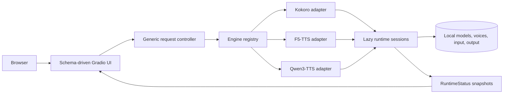

# TTS Workbench

TTS Workbench is a self-hosted, multi-engine text-to-speech platform with one
local Gradio interface for narration, voice cloning, and emerging TTS models.
It exists to make engines with very different controls and runtime requirements
usable through a consistent workflow without sending text, reference recordings,
or generated audio to a hosted application.

The current application supports fast preset-voice narration with Kokoro,
reference-audio voice cloning with F5-TTS, and an integrated Qwen3-TTS
CustomVoice runtime. Models load only when first used and generated audio and
metadata remain in local storage.

[Quick start](#quick-start) · [Engines](#engine-support) ·
[Hardware](#hardware-support) · [Storage](#storage-layout) ·
[Architecture](#development-architecture) · [Troubleshooting](#troubleshooting)

## Feature overview

- **One self-hosted UI:** choose an engine and model, then use the controls that
  adapter declares.
- **Multiple synthesis workflows:** preset voices, reference-audio cloning,
  optional transcription, language selection, and model-specific settings.
- **Local artifacts:** model caches, voice assets, source material, generated
  WAV files, and metadata stay in mounted storage.
- **CPU and validated Intel XPU paths:** CPU fallback works without a GPU;
  F5-TTS synthesis and Qwen model loading have been exercised on Intel Arc Pro
  B70 hardware.
- **Runtime visibility:** a collapsible status panel reports model load state,
  device, precision, cleanup progress, timing, real-time factor, warnings, and
  errors.
- **Extensible by design:** adapters and schemas add engines without embedding
  engine-specific behavior in the Gradio frontend.

## Quick start

You need Docker Engine with the Compose plugin, an x86-64 CPU, enough disk space
for the selected models, and network access for first-use model downloads. A GPU
is optional. The default Compose configuration is CPU-compatible and does not
require `/dev/dri`.

```bash
mkdir -p models voices input output config
docker compose up --build
```

Open <http://localhost:7860>, select an engine and model, enter text, and
generate audio. The first request for an engine may take longer while its model
and voice assets download and the runtime loads.

Compose mounts the working directories automatically:

| Repository path | Container path | Contains |
| --- | --- | --- |
| `models/` | `/models` | Model weights and framework caches |
| `voices/` | `/voices` | Preset voice assets |
| `input/` | `/input` | Persistent reference material |
| `output/` | `/output` | Generated audio and metadata |
| `config/` | `/config` | Persistent application configuration |

Press `Ctrl+C` to stop the foreground service, then run `docker compose down`
when you want to remove its container. Intel XPU users should build the image
normally and use the [device-passthrough command](#intel-xpu-docker-run).

## Engine support

| Engine | Maturity | Active runtime | Devices |
| --- | --- | --- | --- |
| Kokoro | **Fully supported** | Kokoro 82M | CPU (FP32) |
| F5-TTS | **Fully supported** | F5-TTS v1 Base | CPU or Intel XPU (FP32) |
| Qwen3-TTS | **Integrated** | Qwen3-TTS 12Hz 0.6B CustomVoice | CPU (FP32) or Intel XPU (BF16/FP32) |

“Fully supported” means the listed workflow has an end-to-end runtime and test
coverage. “Integrated” means the listed active model has a runtime in the main
application, while additional models may be descriptors only. Descriptor-only
Qwen models are visible foundations for future work and cannot generate audio.

### Kokoro

Kokoro is the fast narration engine. It provides:

- a catalog of 54 preset voices;
- voice selection and speech-speed control;
- voice descriptors with stable IDs, display names, language, gender,
  category, and accent where known;
- American and British English, Japanese, Mandarin Chinese, Spanish, French,
  Hindi, Italian, and Brazilian Portuguese voice groups;
- serialized CPU inference using FP32; and
- lazy download of the selected voice asset.

Kokoro model files are stored under `models/kokoro/kokoro-82m/`, while voice
assets are stored independently under `voices/kokoro/`.

### F5-TTS

F5-TTS is the reference-audio voice-cloning engine. It supports:

- a required reference recording;
- an optional exact reference transcript;
- automatic reference transcription when the transcript is omitted;
- speech-speed control;
- CPU synthesis; and
- Intel XPU synthesis.

Reference uploads include:

- WAV
- M4A
- MP3
- WebM
- Ogg

FFmpeg performs the initial decode and converts the source into mono, 24 kHz,
16-bit PCM WAV. SoundFile is the final decoder into the numeric data passed to
F5. FFmpeg-supported formats such as FLAC also work, although the formats above
cover the normal upload and browser-recording paths.

If reference text is supplied, it is passed directly to F5 and Whisper is not
loaded. If it is blank, the explicit `WhisperProcessor` and
`WhisperForConditionalGeneration` path transcribes normalized 16 kHz audio on
CPU. F5 synthesis remains on its selected CPU or XPU device while transcription
stays on CPU.

### Qwen3-TTS

Qwen3-TTS is integrated into the main adapter registry. The active inference
runtime is:

```text
Qwen/Qwen3-TTS-12Hz-0.6B-CustomVoice
```

It supports nine preset speakers, language selection, sampling controls, lazy
checkpoint download, CPU fallback, Intel XPU selection, and runtime status
reporting.

The adapter also exposes schemas and model descriptors for:

- `Qwen/Qwen3-TTS-12Hz-0.6B-Base`
- `Qwen/Qwen3-TTS-12Hz-1.7B-CustomVoice`
- `Qwen/Qwen3-TTS-12Hz-1.7B-Base`
- `Qwen/Qwen3-TTS-12Hz-1.7B-VoiceDesign`

Those four descriptors let the generic UI represent voice cloning, larger
CustomVoice, and VoiceDesign inputs, but their inference paths are not yet
integrated. Only the 0.6B CustomVoice model should be treated as active.

The UI records and forwards a style instruction for the active model. The
published 0.6B CustomVoice implementation currently clears `instruct`
internally, so the instruction does not provide reliable acoustic style control.
Output metadata explicitly records that limitation. The field remains available
for schema compatibility and future model support.

Qwen imports are lazy. Missing Qwen packages do not prevent the application,
Kokoro, or F5-TTS from starting.

## Example workflow

1. Select **Kokoro** for fast preset narration, **F5-TTS** to clone a reference
   recording, or the active **Qwen3-TTS** model for a multilingual preset voice.
2. The UI displays only the fields declared by that engine/model schema.
3. Enter synthesis text and provide the selected workflow's voice or reference
   inputs.
4. Generate. The adapter validates the request, lazily loads or reuses its
   runtime session, and writes a normalized WAV plus JSON metadata.
5. Play or download the audio and expand **Runtime status** to inspect the
   device, precision, load state, timing, real-time factor, or any error.

## Hardware support

| Backend/hardware | Current support | Validation boundary |
| --- | --- | --- |
| x86-64 CPU | Supported | Kokoro, F5-TTS, and active Qwen runtime paths; performance depends on the host |
| Intel Arc Pro B70 | Validated where noted | F5-TTS XPU synthesis; Qwen 0.6B CustomVoice import/model load |
| Other Intel XPU devices | Not hardware-validated | May work with compatible drivers and runtimes, but no compatibility claim is made |
| NVIDIA CUDA | Architecture only | No CUDA runtime or CUDA Docker image is currently provided |

### CPU

CPU is always available as the fallback backend. Kokoro is CPU-only. F5-TTS and
the active Qwen runtime also support CPU, although their larger models may be
slower than interactive workloads require.

### Intel XPU

The development image uses `torch==2.11.0+xpu` and matching Torchaudio wheels.
F5-TTS and Qwen select XPU automatically when `torch.xpu.is_available()` is
true; otherwise they fall back to CPU. Kokoro remains on CPU.

Atlas validation with an Intel Arc Pro B70 confirmed:

- Intel device passthrough into the Ubuntu container;
- PyTorch XPU detection with the Intel OpenCL and Level Zero runtimes;
- F5-TTS model loading and synthesis on XPU; and
- Qwen3-TTS 0.6B CustomVoice package import and model loading on XPU.

The CPU-only dockerbuilder cannot validate XPU hardware, so XPU generation
checks remain an Atlas responsibility.

### CUDA architecture

The domain contracts and generic runtime-status model can represent a `cuda`
backend without UI changes. The current adapters and development image do not
ship a CUDA runtime: Kokoro accepts CPU, and F5/Qwen currently accept CPU or
XPU. CUDA engine enablement requires a compatible PyTorch image and explicit
adapter runtime validation; it is an architectural extension point, not a
currently validated execution mode.

## Installation

### Docker development environment

Docker is the recommended way to run all current engine dependencies together.
The image uses Ubuntu 26.04 with Python 3.11 copied from the official Python
runtime stage. It includes Gradio, Kokoro, F5-TTS, Qwen3-TTS, FFmpeg,
libsndfile, SoX, eSpeak NG, the PyTorch XPU build, and the Intel GPU userspace
runtime.

Build and start the CPU-compatible Compose service:

```bash
docker compose up --build
```

Open <http://localhost:7860>. The Compose service exposes port `7860`, mounts
the source tree read-only for development, and persists all five storage paths.
The same image starts normally without `/dev/dri` and falls back to CPU.

Stop it with:

```bash
docker compose down
```

### Intel XPU Docker run

The host needs a working Intel graphics driver and a usable `/dev/dri` render
device. Pass DRI into the container:

```bash
docker run --rm \
  --name tts-workbench \
  --device=/dev/dri:/dev/dri \
  --publish 7860:7860 \
  --volume "$PWD/models:/models" \
  --volume "$PWD/voices:/voices" \
  --volume "$PWD/input:/input" \
  --volume "$PWD/output:/output" \
  --volume "$PWD/config:/config" \
  tts-workbench:dev
```

To pass only the render node used during Atlas validation, replace the device
argument with:

```text
--device=/dev/dri/renderD131:/dev/dri/renderD131
```

Device discovery can be checked without starting Gradio:

```bash
docker run --rm \
  --device=/dev/dri:/dev/dri \
  tts-workbench:dev \
  tts-workbench-devices --device xpu --xpu-index 0 --json
```

### Local CPU development

Use Python 3.11. Native audio packages are required for the full runtime; on a
Debian or Ubuntu development host:

```bash
sudo apt-get update
sudo apt-get install ffmpeg libsndfile1 sox espeak-ng
python3.11 -m venv .venv
. .venv/bin/activate
python -m pip install --upgrade pip setuptools wheel
python -m pip install --editable .
```

Install only the engines needed in that environment:

```bash
python -m pip install --editable '.[kokoro]'
python -m pip install --editable '.[f5]'
python -m pip install --editable '.[qwen]'
```

Or install all engine extras together:

```bash
python -m pip install --editable '.[kokoro,f5,qwen]'
```

Install the backend-appropriate matching Torch and Torchaudio wheels before the
engine extras. Qwen requires `qwen-tts==0.1.1`, `transformers==4.57.3`, and
`accelerate==1.12.0`; the Docker image pins that validated combination with
Torch/Torchaudio `2.11.0+xpu`. Flash Attention is intentionally not installed.

Launch the application from the repository root:

```bash
tts-workbench-devices
tts-workbench
```

The base install contains Gradio and the engine descriptors. Optional engine
dependencies are imported only when their runtime is requested.

## Docker runtime details

| Item | Current value |
| --- | --- |
| Base OS | Ubuntu 26.04 |
| Python | 3.11 |
| HTTP port | 7860 |
| Torch | 2.11.0 XPU build by default |
| Intel userspace packages | `intel-opencl-icd`, `libze1`, `libze-intel-gpu1` |
| Persistent paths | `/models`, `/voices`, `/input`, `/output`, `/config` |
| Healthcheck | HTTP request to `127.0.0.1:7860` |

The application is configured with `TTS_WORKBENCH_ROOT=/` in the image. Model
and framework caches also live below `/models`, so recreating a container does
not require downloading every artifact again.

The entrypoint checks that all storage paths are writable, prints CPU/XPU
diagnostics, and then starts Gradio. Models are downloaded lazily rather than
baked into the image.

## Runtime Status panel

The bottom of the Gradio interface contains one collapsible, engine-independent
Runtime Status panel. It consumes immutable `RuntimeStatus` snapshots and is
updated on engine/model selection, before generation, after a runtime session
loads, during asynchronous unload/device cleanup, after generation, and after
handled failures.

It reports:

- active engine and model;
- active loaded runtime, independently from the selected form;
- lifecycle state (`unloaded`, `loading`, `generating`, `ready`, `unloading`,
  or `error`);
- device backend (`cpu`, `xpu`, or future `cuda`);
- device name when available;
- precision when available;
- whether the runtime is loaded;
- device cleanup state and cache-clear result;
- last generation duration;
- generated audio duration;
- real-time factor; and
- warnings and errors.

Real-time factor is generation time divided by generated audio duration. A value
below `1.0×` means generation was faster than real time.

```text
Active engine: F5-TTS (f5)
Active model: F5-TTS v1 Base (f5-tts-v1-base)
State: ready
Device backend: xpu
Device name: Intel Arc Pro B70
Precision: fp32
Runtime loaded: yes
Last generation: 2.000 s
Generated audio: 5.000 s
Real-time factor: 0.400×
```

## Storage layout

With a repository-local development root, runtime storage looks like:

```text
models/
├── .cache/
├── f5/
│   └── f5-tts-v1-base/
├── kokoro/
│   └── kokoro-82m/
└── qwen/
    └── Qwen3-TTS-12Hz-0.6B-CustomVoice/
voices/
└── kokoro/
    ├── af_heart.pt
    └── ...
input/
output/
└── YYYY-MM-DD/
    └── <job-id>/
        ├── audio.wav
        └── metadata.json
config/
```

| Path | Purpose |
| --- | --- |
| `models/` | Engine weights and persistent framework caches |
| `voices/` | Independently downloaded preset voice assets |
| `input/` | Persistent user-managed reference audio and text |
| `output/` | Date/job-scoped generated WAV files and JSON metadata |
| `config/` | Persistent configuration storage reserved for application settings |

In Docker these map directly to `/models`, `/voices`, `/input`, `/output`, and
`/config`. Gradio is allowed to serve generated files from `/output` and trusted
inputs from `/voices` and `/input`; `/models` is intentionally not exposed.

## Troubleshooting

### XPU is not detected

First verify that the render device exists and is accessible on the host:

```bash
ls -la /dev/dri
```

Then verify that it was passed into the container and that the XPU-enabled Torch
build is installed:

```bash
docker run --rm --device=/dev/dri:/dev/dri tts-workbench:dev \
  python -c 'import torch; print(torch.__version__); print(torch.xpu.is_available()); print(torch.xpu.device_count())'
```

If the device is visible but `torch.xpu.is_available()` is false, check host
driver compatibility, render-node permissions, container device mapping, and
the Intel userspace packages described below. CPU fallback is expected when no
usable XPU exists.

### Intel Level Zero runtime is missing

The development image installs the packages needed by the known-good Atlas
environment:

- `intel-opencl-icd`
- `libze1`
- `libze-intel-gpu1`

Verify them inside the image:

```bash
docker run --rm --entrypoint dpkg-query tts-workbench:dev \
  --show intel-opencl-icd libze1 libze-intel-gpu1
```

An image based on a distribution that lacks `libze-intel-gpu1` can expose a DRI
render node while still failing PyTorch XPU detection. Use the provided Ubuntu
image or install a matching Intel Level Zero runtime.

### Optional engine dependencies are missing

The application intentionally starts without every model package. An engine
dependency error means the selected adapter reached its lazy runtime boundary.
Install the corresponding extra:

```bash
python -m pip install --editable '.[kokoro]'
python -m pip install --editable '.[f5]'
python -m pip install --editable '.[qwen]'
python -m pip check
```

For Qwen, also confirm that the exact validated versions are present:

```bash
python -c 'import importlib.metadata as m; print(m.version("qwen-tts")); print(m.version("transformers")); print(m.version("accelerate"))'
```

Expected values are `0.1.1`, `4.57.3`, and `1.12.0` respectively.

### Reference audio fails to decode

Confirm that FFmpeg is installed and can inspect the upload:

```bash
ffmpeg -hide_banner -i reference.m4a
```

To create a known-good F5 reference manually:

```bash
ffmpeg -i reference.m4a -vn -ac 1 -ar 24000 -c:a pcm_s16le reference.wav
```

Use a short, clean recording with audible speech. F5 reads at most the first 12
seconds. Browser recordings may use WebM or Ogg containers even when the file
extension is unexpected; FFmpeg performs format detection from the content.

### Model download fails

Kokoro, F5-TTS, Qwen3-TTS, and Whisper obtain missing artifacts on first use.
Check:

- internet and DNS access to the model host;
- available disk space under `models/` or `/models`;
- write permissions on `models/`, `voices/`, and their mounted counterparts;
- proxy or Hugging Face authentication requirements; and
- whether an interrupted download left an incomplete local checkpoint.

Container logs and the Runtime Status panel contain the underlying load error:

```bash
docker logs tts-workbench
```

Do not put model storage behind Gradio's allowed paths; model files are runtime
assets and should remain private.

## Development architecture



- **Adapter registry:** each engine implements the common adapter interface and
  registers an engine descriptor, model descriptors, capabilities, voices,
  inputs, settings, generation, and optional runtime-status reporting.
- **Schema-driven UI:** Gradio creates persistent generic components from engine
  schemas. Switching engines or models changes visible forms without adding
  `if engine == ...` logic to the frontend.
- **Normalized requests/results:** the controller translates component values
  into `SynthesisRequest`; every runtime returns `SynthesisResult` with engine,
  model, audio path, sample rate, duration, and generation timing.
- **Runtime status:** immutable snapshots merge selected descriptors, hardware
  availability, loaded adapter sessions, timings, warnings, and errors. The UI
  only formats this shared status contract.
- **Lazy loading and lifecycle management:** engine packages import at session
  creation, and the active session is reused until the selected engine/model
  changes. Selection itself remains descriptor-only; a generic runtime manager
  unloads stale sessions, releases references, runs garbage collection, and
  clears XPU/CUDA allocator caches without blocking the selection callback.
- **Engine isolation:** Kokoro, F5-TTS, and Qwen3-TTS runtime code remains
  separate from the generic Gradio renderer.

Run the test suite from the repository root:

```bash
PYTHONPATH=src python -m unittest discover -s tests -v
```

The standalone Qwen probe and its historical validation notes are documented in
[`experiments/qwen/README.md`](experiments/qwen/README.md) and
[`docs/qwen-runtime-research.md`](docs/qwen-runtime-research.md).
